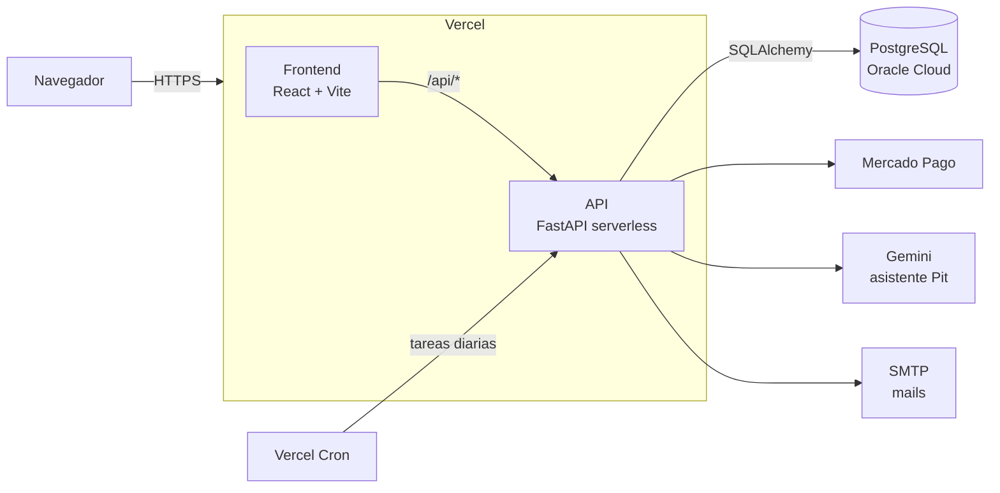

<div align="center">


# AutoBought

**Tienda online de repuestos de auto que te muestra solo lo que le sirve a tu vehículo.**

[](https://github.com/JoaquinRodriguez07/AutoBought/actions/workflows/ci.yml)
[](https://github.com/JoaquinRodriguez07/AutoBought/actions/workflows/e2e.yml)
[](https://sonarcloud.io/summary/new_code?id=JoaquinRodriguez07_AutoBought)

[**Ver la tienda en vivo →**](https://autobought-pearl.vercel.app)

</div>

---

## Sobre el proyecto

AutoBought es un e-commerce de repuestos automotrices desarrollado para la materia **Ingeniería de Software II** de la Universidad de Montevideo (UM), con Scrum en sprints de dos semanas.

El problema que resuelve: comprar un repuesto online sin saber si le sirve a tu auto. En AutoBought el cliente elige su vehículo una vez y toda la tienda (catálogo, búsqueda, recomendaciones y asistente) le muestra solo repuestos compatibles. Del otro lado, el vendedor tiene un dashboard que proyecta la demanda y le avisa qué reponer antes de quedarse sin stock.

## Funcionalidades

**Para el cliente**
- 🚗 **Compatibilidad real:** más de 3.900 repuestos de 24 marcas, filtrados por marca, modelo y motor.
- 🔎 **Catálogo y búsqueda:** filtros por categoría, fabricante y precio, y búsqueda libre.
- 🛒 **Compra completa:** carrito, favoritos, avisos de vuelta de stock y pago con **Mercado Pago**.
- 📦 **Seguimiento del pedido:** línea de tiempo del pedido, confirmación de entrega y mails en cada etapa.
- 🤖 **Pit, asistente con IA:** el cliente cuenta qué le pasa al auto y Pit le sugiere los repuestos compatibles que hay en stock.

**Para el vendedor**
- 📈 **Dashboard predictivo:** evolución de ventas, más vendidos, proyección de demanda y riesgo de agotamiento.
- 🔔 **Alertas de reposición** y gestión de repuestos y stock.
- 👥 **Equipo:** un administrador da de alta y de baja vendedores.

## Arquitectura



Los diagramas de componentes, de despliegue y de secuencia están en [`diagrams/`](diagrams/).

## Tecnologías

| Capa | Tecnologías |
|---|---|
| Frontend | React 19, Vite, React Router, Tailwind, Recharts |
| Backend | Python 3.14, FastAPI, SQLAlchemy 2, Alembic, uv |
| Base de datos | PostgreSQL 17 |
| Integraciones | Mercado Pago (Checkout Pro), Google Gemini, SMTP |
| Calidad | Pytest, Jest, Playwright (E2E), GitHub Actions, CodeRabbit |
| Infraestructura | Vercel (frontend, API y cron), Oracle Cloud (base de datos), Docker |

## Empezar en local

Requisitos: **Docker** y **Git**.

```bash
git clone https://github.com/JoaquinRodriguez07/AutoBought.git
cd AutoBought
cp .env.example .env          # completar LOCAL_DB_PASSWORD y SECRET_KEY

docker compose up -d
docker exec backend uv run alembic upgrade head            # crea las tablas
docker exec backend uv run python -m scripts.seed          # catálogo
docker exec backend uv run python -m scripts.seed_demo_users
```

| Servicio | Dirección |
|---|---|
| Tienda | http://localhost:5173 |
| API (documentación interactiva) | http://localhost:8000/docs |
| Mails de prueba (Mailpit) | http://localhost:8025 |

Los usuarios de prueba, la carga del historial de ventas, las migraciones, los tests y el resto de los detalles técnicos están en la **[Guía de desarrollo](docs/GUIA-DESARROLLO.md)**.

## Estructura del repositorio

```text
AutoBought/
├── backend/          API en FastAPI: modelos, endpoints, IA, migraciones y seeds
├── frontend/         Tienda y dashboard en React
├── tests/            Tests del backend (Pytest)
├── e2e/              Tests de punta a punta (Playwright)
├── diagrams/         Diagramas de arquitectura
├── docs/             Documentación técnica
└── vercel.json       Despliegue y cron en Vercel
```

## Calidad

- **CI en cada PR:** tests de backend (con un mínimo de 70 % de cobertura) y de frontend.
- **E2E en cada merge a `dev`:** recorridos completos en un navegador real.
- **Ramas protegidas:** `dev` pide 1 aprobación y `main`, 2.

---

<div align="center">
<sub>Ingeniería de Software II · Universidad de Montevideo (UM) · 2026</sub>
</div>
