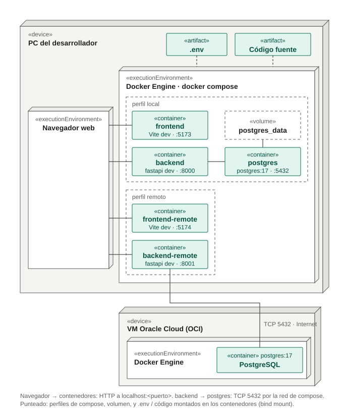

# Diagrama de despliegue — Desarrollo (Docker Compose)

Cómo se levanta el sistema en la máquina de cada desarrollador con
`docker compose`.

- **Perfil `local`** (por defecto, `COMPOSE_PROFILES=local`): frontend, backend y
  una base PostgreSQL propia en un contenedor, con el volumen `postgres_data`.
- **Perfil `remoto`** (`docker compose --profile remoto up -d`): frontend y
  backend que se conectan a la base de la VM de Oracle Cloud.
- El código fuente se monta en los contenedores (hot reload) y las credenciales
  salen del `.env` de la raíz (ver `.env.example`).
