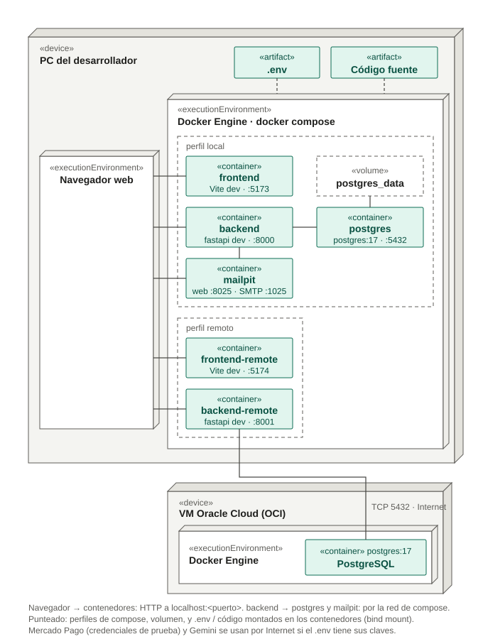

# Diagrama de despliegue — Desarrollo (Docker Compose)

Cómo se levanta el sistema en la máquina de cada desarrollador con
`docker compose`.

- **Perfil `local`** (por defecto, `COMPOSE_PROFILES=local`): frontend, backend,
  una base PostgreSQL propia en un contenedor (con el volumen `postgres_data`) y
  **Mailpit**, un servidor de mail falso: recibe los mails del backend y los
  muestra en <http://localhost:8025> sin mandar nada real.
- **Perfil `remoto`** (`docker compose --profile remoto up -d`): frontend y
  backend que se conectan a la base de la VM de Oracle Cloud.
- El código fuente se monta en los contenedores (hot reload) y las credenciales
  salen del `.env` de la raíz (ver `.env.example`).
- **Mercado Pago:** en local se usan las credenciales de prueba
  (`MERCADOPAGO_ACCESS_TOKEN`). Sin token la tienda no acepta pedidos (503). Como
  `BACKEND_URL` queda vacía, Mercado Pago no tiene adónde mandar el webhook: el
  pago se confirma cuando el cliente vuelve a `/pago` (botón "Volver al sitio").
- **Gemini** se usa solo si el `.env` tiene `GEMINI_API_KEY`.
