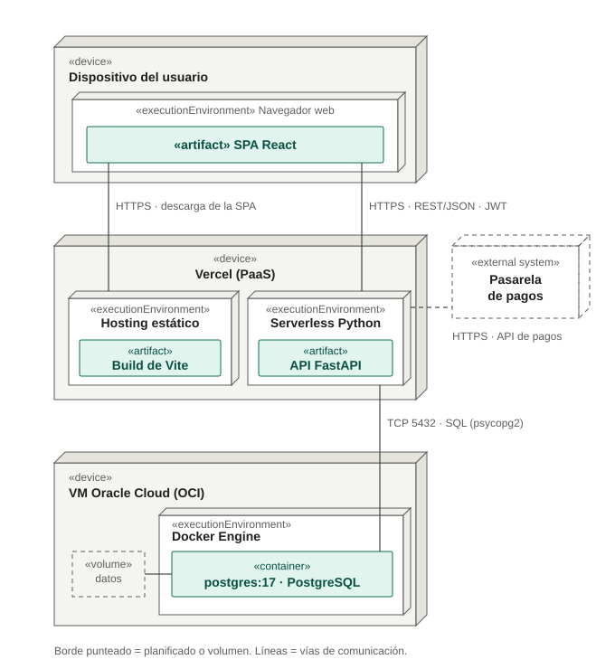

# Diagrama de despliegue — Producción

Dónde corre cada parte del sistema en producción y cómo se comunican.

- **Dispositivo del usuario:** el navegador ejecuta la SPA de React.
- **Vercel:** sirve el build estático de Vite y ejecuta la API FastAPI como
  función serverless de Python.
- **VM de Oracle Cloud (OCI):** PostgreSQL 17 en un contenedor Docker, con sus
  datos en un volumen.
- **Pasarela de pagos:** sistema externo, planificado (borde punteado).

**Pendiente de confirmar:** si la conexión Vercel → Postgres (TCP 5432) va cifrada
con TLS y si hay algún proxy inverso o firewall delante de la VM.
