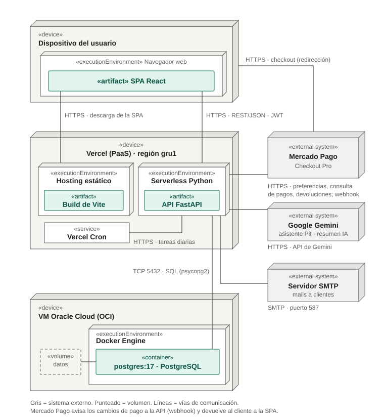

# Diagrama de despliegue — Producción

Dónde corre cada parte del sistema en producción y cómo se comunican.

- **Dispositivo del usuario:** el navegador ejecuta la SPA de React. Para pagar,
  la SPA lo redirige al checkout de Mercado Pago, que al terminar lo devuelve a
  `/pago?pedido=…`.
- **Vercel** (región `gru1`): sirve el build estático de Vite y ejecuta la API
  FastAPI como función serverless de Python (todo lo que empieza con `/api/` va
  al backend, ver `vercel.json`). **Vercel Cron** llama a
  `GET /api/v1/tareas/diarias` una vez por día (13:00 UTC), con `CRON_SECRET`.
- **VM de Oracle Cloud (OCI):** PostgreSQL 17 en un contenedor Docker, con sus
  datos en un volumen.
- **Mercado Pago (Checkout Pro):** la API crea la preferencia (el link de pago),
  consulta el estado de cada pago y hace las devoluciones. Mercado Pago avisa los
  cambios de pago a `POST /api/v1/pagos/webhook`, firmado con
  `MERCADOPAGO_WEBHOOK_SECRET`.
- **Google Gemini:** el asistente de compra (Pit), el resumen con IA y las
  preguntas al dashboard del vendedor.
- **Servidor SMTP:** los mails a los clientes (verificación, compra, cambios de
  estado, avisos de stock).

**Pendiente de confirmar:** si la conexión Vercel → Postgres (TCP 5432) va cifrada
con TLS y si hay algún proxy inverso o firewall delante de la VM.
