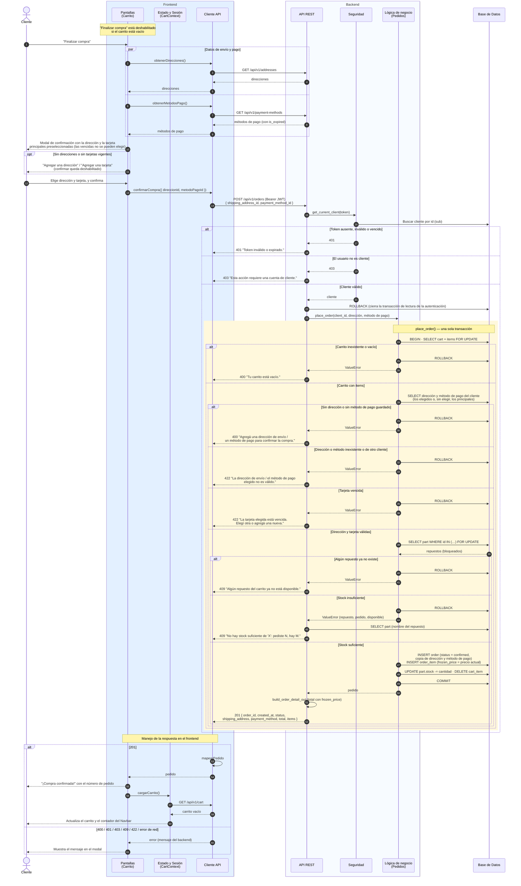

# Secuencia: finalizar compra

> **Implementado:** `POST /api/v1/orders` con body opcional
> `{ shipping_address_id, payment_method_id }` (lo que no se envía usa la dirección
> o el método principal del cliente) y la transacción `place_order()` de
> `backend/app/crud/order.py` (recuadro amarillo). El pedido nace en estado
> `confirmed` y guarda una copia de la dirección y del método de pago, para que el
> historial no cambie si el cliente los edita o borra.
>
> **Planificado (a confirmar con el equipo):** el cobro con la pasarela de pagos,
> con el orden "primero se reserva el stock y se crea el pedido, después se cobra".
> El estado del cobro iría en una entidad de pago aparte; el `status` del pedido es
> solo logístico (confirmado / enviado / entregado / cancelado). Hoy no se cobra.

