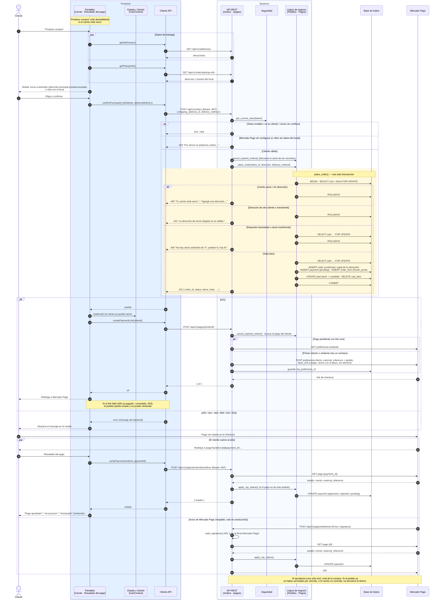

# Secuencia: finalizar compra

> **Implementado:** la compra tiene dos pasos. Primero `POST /api/v1/orders`
> (body opcional `{ shipping_address_id, delivery_method }`) arma el pedido con la
> transacción `place_order()` de `backend/app/crud/order.py` (recuadro amarillo):
> descuenta el stock y vacía el carrito, y el pedido nace `confirmed` con su
> **pago pendiente** (entidad `payment` aparte). Después el cliente paga en
> **Mercado Pago (Checkout Pro)**: `POST /api/v1/pagos/{id}` da el link, y el pago
> se confirma al volver a `/pago` (`POST /api/v1/pagos/{id}/verificar`) o por el
> aviso de Mercado Pago (`POST /api/v1/pagos/webhook`), lo que llegue primero.
> En los dos casos no se le cree al aviso: se consulta el pago a Mercado Pago.
>
> El stock queda reservado `MINUTOS_PARA_PAGAR` minutos (15 por defecto). Si el
> pedido no se paga a tiempo, `cancel_expired_orders()` lo cancela y devuelve el
> stock; si el pago se aprueba igual después, se le devuelve el dinero.
> El `status` del pedido es solo logístico; el estado del cobro vive en `payment`.

