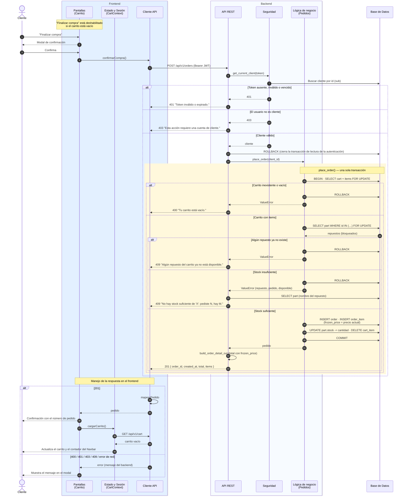

# Secuencia: finalizar compra

> **Alcance actual:** confirmar la compra crea el pedido a partir del carrito,
> descuenta el stock y vacía el carrito, todo en una transacción
> (`place_order()` en `crud/order.py`). **Todavía no hay cobro:** no se elige
> método de pago ni dirección de envío, y no hay integración con una pasarela
> de pagos (planificada, ver el diagrama de componentes).

