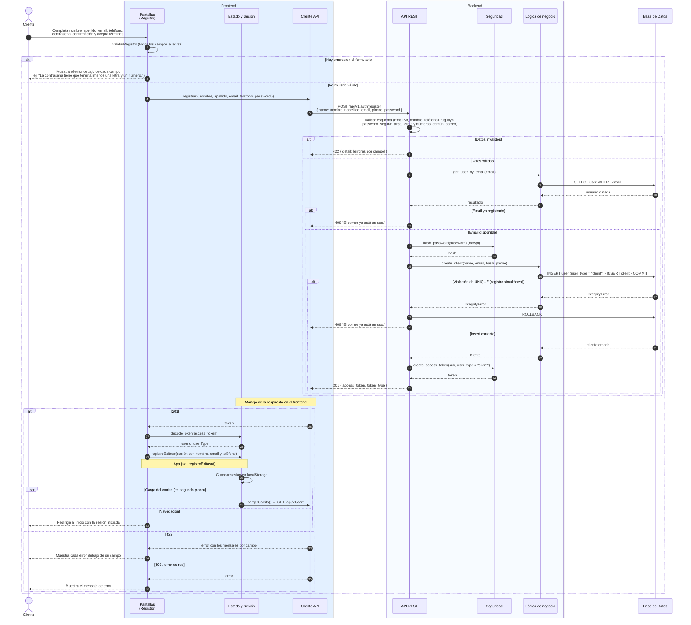

# Secuencia: registro de cliente

> El formulario pide nombre y apellido por separado, pero el backend guarda un
> único `name`: el frontend los envía unidos. El registro devuelve el mismo token
> que el login, así que la sesión queda iniciada.
>
> Las reglas de validación son las mismas en el frontend (`validaciones.js`, avisa
> antes de enviar) y en el backend (`core/validators.py`, la que vale):
> - **Nombre y apellido:** solo letras, espacios, apóstrofos y guiones; al menos 2 letras.
> - **Teléfono:** obligatorio y uruguayo.
> - **Contraseña:** al menos 8 caracteres (máximo 72 bytes), con al menos una letra
>   y un número; no puede ser una contraseña común ni contener el usuario del correo.

