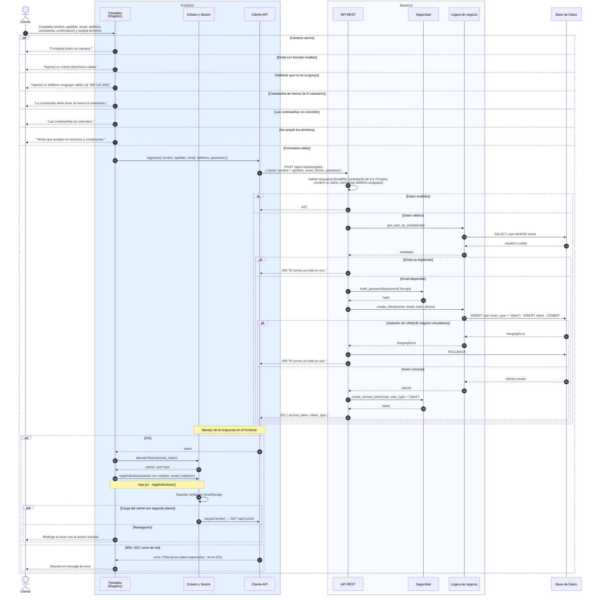

# Secuencia: registro de cliente

> El formulario pide nombre y apellido por separado, pero el backend guarda un
> único `name`: el frontend los envía unidos. El registro devuelve el mismo token
> que el login, así que la sesión queda iniciada.

